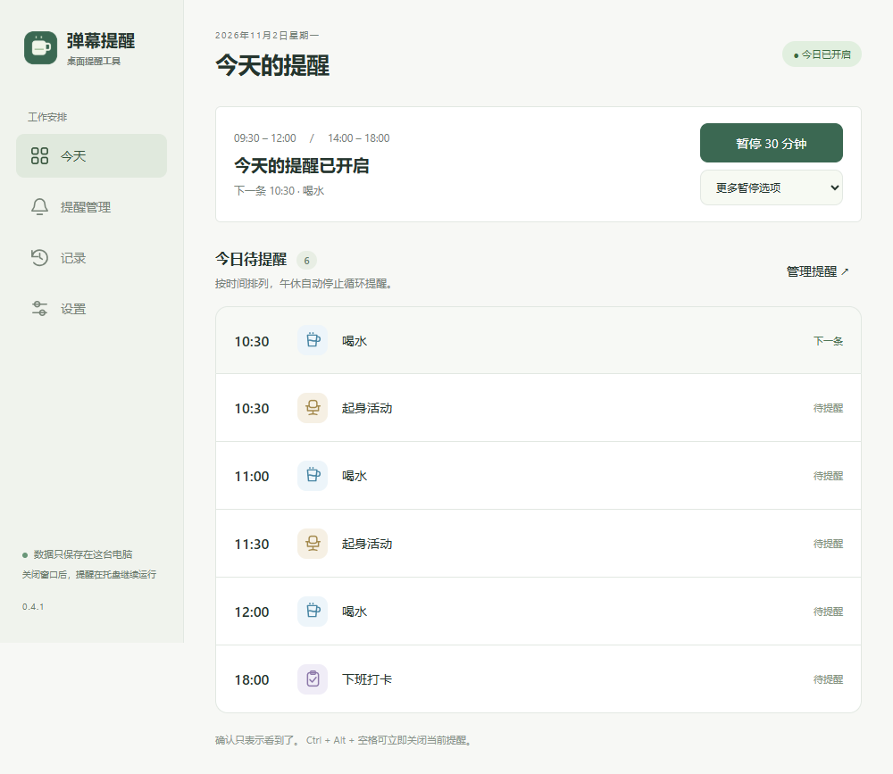
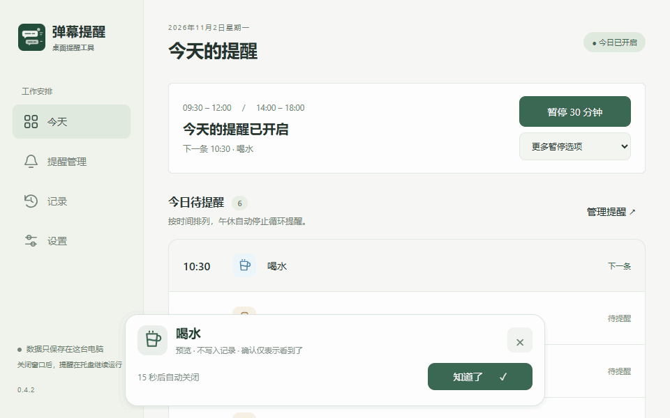

# 弹幕提醒

用桌面弹幕提醒你喝水、起身活动和上下班打卡。

[文档站](https://yinzhenCoder.github.io/remember-desktop/) · [Wiki 源文件](wiki/Home.md) · [问题反馈](https://github.com/yinzhenCoder/remember-desktop/issues)

## 界面与操作





截图与动图由实际前端代码渲染，使用示例数据，不包含个人提醒记录。

## 功能

- 工作时段内循环提醒，午休重新计算间隔。
- 工作日指定时间提醒，可添加自定义事项。
- 弹幕数量、轮数、速度、分散程度和文案设置。
- 固定确认条、托盘暂停、快捷关闭和重要提醒浮条。
- 本地记录与 JSON / CSV 导出。

「知道了」只表示看到提醒，不表示事项已完成。软件不会自动打卡，也不检测是否喝水或起身。

## 运行

需要 Windows x64、Node.js 24 或更高版本。

```sh
npm ci
npm start
```

首次设置工作日与工作时段，保存后开启当天提醒。默认喝水每 30 分钟、起身每 60 分钟。

## 开发

```sh
npm test
npm run format:check
npm run docs:build
npm run build:portable
```

便携程序位于 `dist/win-unpacked/弹幕提醒.exe`，运行时需要保留整个目录。`npm run build` 生成 NSIS 安装包。Windows 发布工作流提供构建产物，仍需实机验证。

## 文档

```sh
npm run docs:dev
npm run wiki:generate
```

VitePress 文档在 `docs/`，同一份内容生成 Wiki 到 `wiki/`。主分支推送后部署 Pages，首次设置见 [发布说明](docs/development/publishing.md)。

## 数据与范围

数据只保存本机，实际位置见「设置 → 打开数据文件夹」。当前不支持自动识别屏幕共享、节假日调休、独立的全天/周末提醒、多浮条堆叠。这些功能见 [路线图](docs/roadmap.md)。

贡献请阅读 [CONTRIBUTING.md](CONTRIBUTING.md)。许可为 [MIT](LICENSE)。
