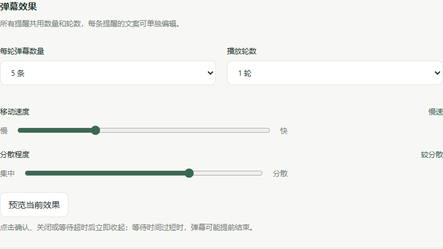

# 弹幕设置

设置数量、轮数、速度和分散程度后，可先点击预览；保存后用于后续提醒。

| 设置     | 范围            |
| -------- | --------------- |
| 每轮数量 | 1–7 条          |
| 轮数     | 1 或 2 轮       |
| 移动速度 | 100–500 像素/秒 |
| 分散程度 | 0–100           |

速度越低移动越慢，分散程度越高入场时间错开越明显。默认 5 条、1 轮、速度 220、分散程度 70。系统启用减少动态效果时静态显示。

提醒管理中每行设置一条文案，最多 20 条、每条 60 字。喝水和起身有预制文案，其他提醒留空使用名称。

设置页的效果预览固定使用普通喝水提醒。测试重要浮条需先保存浮条开关，再从提醒管理预览重要提醒。

确认、关闭或超时立即停止弹幕；慢速多轮可能在播完前结束。
