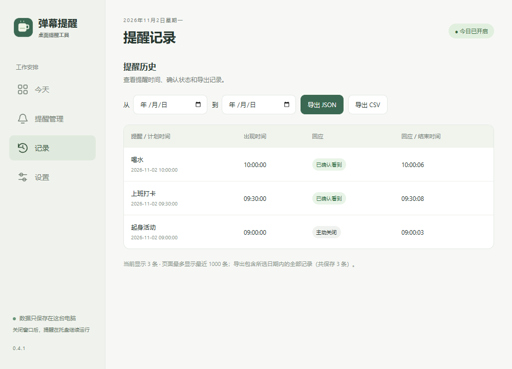

# 数据与导出

在「记录」中按日期查看回应状态，选择 JSON 或 CSV 导出。

软件不上传提醒数据。设置页可打开实际数据目录，通常在 `%APPDATA%/Remember/data`。

软件更名为「弹幕提醒」后，沿用这个目录以保留旧版设置和记录；文件夹名称不随显示名称改变。

- `settings.json`：配置和当天运行状态。
- `events.jsonl`：追加式事件快照，同一 ID 的最后一行代表最新状态。

记录页显示最近 1000 条，导出包含所选日期内全部记录。JSON 包含配置、版本、时区和事件；CSV 使用 UTF-8 BOM。

| 字段                   | 含义                                                                              |
| ---------------------- | --------------------------------------------------------------------------------- |
| event_id / reminder_id | 事件 / 规则 ID                                                                    |
| scheduled_at           | 计划时间                                                                          |
| displayed_at           | 实际出现时间，未展示时为空                                                        |
| status                 | queued / displayed / acknowledged / dismissed / timed_out / skipped / interrupted |
| acknowledged_at        | 点击知道了的时间                                                                  |
| ended_at / reason      | 结束时间 / 原因                                                                   |
| timezone               | 事件发生时的时区                                                                  |

时间字段是 ISO 8601 UTC，界面按本地时间显示。acknowledged 不能推断用户完成了喝水、起身或打卡。预览不写正式记录，浮条消失不改变确认记录。
