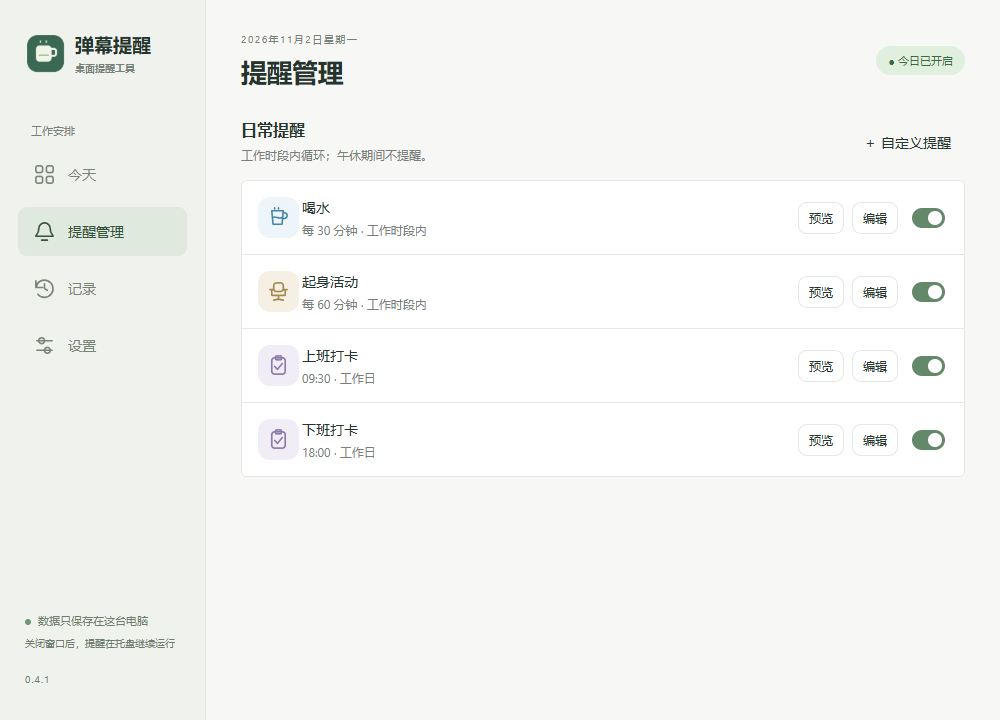
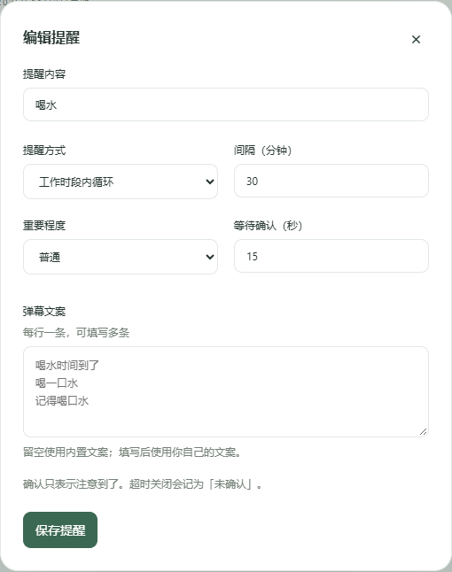

# 提醒规则

在「提醒管理」中查看开关、触发时间和等待确认时长。预览不会写入正式记录。

点击「编辑」修改名称、循环间隔或定时时间、重要程度和弹幕文案。

## 循环与定时

循环提醒从每段工作时段加一个间隔开始。09:30 开始、间隔 30 分钟时第一次为 10:00。午休停止，下午重新计算。恰好落在结束时间的提醒照常出现。

定时提醒在所选工作日指定时间触发。当前自定义提醒也遵循工作日，全天和周末独立规则尚未实现。

## 确认

「知道了」记录已确认看到及时间；× 和快捷键记录主动关闭；等待结束记录超时未确认。默认普通提醒等待 15 秒，重要提醒 60 秒，可设置 5–600 秒。确认不改变下一次触发时间。

暂停期间不补刷。软件没有运行的历史时段不会回填记录。

## 重要浮条

设置并保存保留浮条开关。重要提醒确认后，原确认条关闭，浮条可拖动并逐渐淡出，保留 30–300 秒。当前只保留最新一条，多条堆叠尚未实现。
